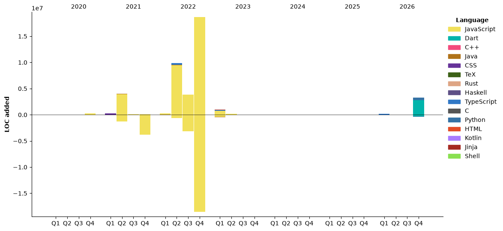

## Contributions
<picture>
  <source media="(prefers-color-scheme: dark)" srcset="https://raw.githubusercontent.com/rowan-vr/rowan-vr/output/github-snake-dark.svg" />
  <source media="(prefers-color-scheme: light)" srcset="https://raw.githubusercontent.com/rowan-vr/rowan-vr/output/github-snake.svg" />
  
</picture>

## Recent Activity
<!--START_SECTION:activity-->
1. 💪 Opened PR [#179](https://github.com/rowan-vr/memuki/pull/179) in [rowan-vr/memuki](https://github.com/rowan-vr/memuki)
2. 💪 Opened PR [#178](https://github.com/rowan-vr/memuki/pull/178) in [rowan-vr/memuki](https://github.com/rowan-vr/memuki)
3. 💪 Opened PR [#177](https://github.com/rowan-vr/memuki/pull/177) in [rowan-vr/memuki](https://github.com/rowan-vr/memuki)
4. 🔒 Closed issue [#174](https://github.com/rowan-vr/memuki/issues/174) in [rowan-vr/memuki](https://github.com/rowan-vr/memuki)
5. 🎉 Merged PR [#175](https://github.com/rowan-vr/memuki/pull/175) in [rowan-vr/memuki](https://github.com/rowan-vr/memuki)
<!--END_SECTION:activity-->

## Statistics
<!--START_SECTION:waka-->


**🐱 My GitHub Data** 

> 📦 ? Used in GitHub's Storage 
 > 
> 🏆 864 Contributions in the Year 2026
 > 
> 🚫 Not Opted to Hire
 > 
> 📜 33 Public Repositories 
 > 
> 🔑 0 Private Repositories 
 > 
**I'm an Early 🐤** 

```text
🌞 Morning                2657 commits        ⬛⬛⬛⬜⬜⬜⬜⬜⬜⬜⬜⬜⬜⬜⬜⬜⬜⬜⬜⬜⬜⬜⬜⬜⬜   11.62 % 
🌆 Daytime                10292 commits       ⬛⬛⬛⬛⬛⬛⬛⬛⬛⬛⬛⬜⬜⬜⬜⬜⬜⬜⬜⬜⬜⬜⬜⬜⬜   45.01 % 
🌃 Evening                9106 commits        ⬛⬛⬛⬛⬛⬛⬛⬛⬛⬛⬜⬜⬜⬜⬜⬜⬜⬜⬜⬜⬜⬜⬜⬜⬜   39.83 % 
🌙 Night                  809 commits         ⬛⬜⬜⬜⬜⬜⬜⬜⬜⬜⬜⬜⬜⬜⬜⬜⬜⬜⬜⬜⬜⬜⬜⬜⬜   03.54 % 
```
📅 **I'm Most Productive on Friday** 

```text
Monday                   2141 commits        ⬛⬛⬜⬜⬜⬜⬜⬜⬜⬜⬜⬜⬜⬜⬜⬜⬜⬜⬜⬜⬜⬜⬜⬜⬜   09.36 % 
Tuesday                  2650 commits        ⬛⬛⬛⬜⬜⬜⬜⬜⬜⬜⬜⬜⬜⬜⬜⬜⬜⬜⬜⬜⬜⬜⬜⬜⬜   11.59 % 
Wednesday                2238 commits        ⬛⬛⬜⬜⬜⬜⬜⬜⬜⬜⬜⬜⬜⬜⬜⬜⬜⬜⬜⬜⬜⬜⬜⬜⬜   09.79 % 
Thursday                 4865 commits        ⬛⬛⬛⬛⬛⬜⬜⬜⬜⬜⬜⬜⬜⬜⬜⬜⬜⬜⬜⬜⬜⬜⬜⬜⬜   21.28 % 
Friday                   5143 commits        ⬛⬛⬛⬛⬛⬛⬜⬜⬜⬜⬜⬜⬜⬜⬜⬜⬜⬜⬜⬜⬜⬜⬜⬜⬜   22.49 % 
Saturday                 2419 commits        ⬛⬛⬛⬜⬜⬜⬜⬜⬜⬜⬜⬜⬜⬜⬜⬜⬜⬜⬜⬜⬜⬜⬜⬜⬜   10.58 % 
Sunday                   3408 commits        ⬛⬛⬛⬛⬜⬜⬜⬜⬜⬜⬜⬜⬜⬜⬜⬜⬜⬜⬜⬜⬜⬜⬜⬜⬜   14.91 % 
```


📊 **This Week I Spent My Time On** 

```text
🕑︎ Time Zone: Europe/Amsterdam

💬 Programming Languages: 
Markdown                 9 hrs 38 mins       ⬛⬛⬛⬛⬛⬛⬛⬛⬜⬜⬜⬜⬜⬜⬜⬜⬜⬜⬜⬜⬜⬜⬜⬜⬜   32.75 % 
Dart                     5 hrs 51 mins       ⬛⬛⬛⬛⬛⬜⬜⬜⬜⬜⬜⬜⬜⬜⬜⬜⬜⬜⬜⬜⬜⬜⬜⬜⬜   19.89 % 
TypeScript               3 hrs 55 mins       ⬛⬛⬛⬜⬜⬜⬜⬜⬜⬜⬜⬜⬜⬜⬜⬜⬜⬜⬜⬜⬜⬜⬜⬜⬜   13.34 % 
Python                   2 hrs 32 mins       ⬛⬛⬜⬜⬜⬜⬜⬜⬜⬜⬜⬜⬜⬜⬜⬜⬜⬜⬜⬜⬜⬜⬜⬜⬜   08.64 % 
YAML                     56 mins             ⬛⬜⬜⬜⬜⬜⬜⬜⬜⬜⬜⬜⬜⬜⬜⬜⬜⬜⬜⬜⬜⬜⬜⬜⬜   03.19 % 

🔥 Editors: 
Claude Code              14 hrs 17 mins      ⬛⬛⬛⬛⬛⬛⬛⬛⬛⬛⬛⬛⬜⬜⬜⬜⬜⬜⬜⬜⬜⬜⬜⬜⬜   48.51 % 
PyCharm                  7 hrs 12 mins       ⬛⬛⬛⬛⬛⬛⬜⬜⬜⬜⬜⬜⬜⬜⬜⬜⬜⬜⬜⬜⬜⬜⬜⬜⬜   24.46 % 
WebStorm                 3 hrs 43 mins       ⬛⬛⬛⬜⬜⬜⬜⬜⬜⬜⬜⬜⬜⬜⬜⬜⬜⬜⬜⬜⬜⬜⬜⬜⬜   12.66 % 
IntelliJ IDEA            3 hrs 14 mins       ⬛⬛⬛⬜⬜⬜⬜⬜⬜⬜⬜⬜⬜⬜⬜⬜⬜⬜⬜⬜⬜⬜⬜⬜⬜   11.03 % 
Webstorm                 34 mins             ⬜⬜⬜⬜⬜⬜⬜⬜⬜⬜⬜⬜⬜⬜⬜⬜⬜⬜⬜⬜⬜⬜⬜⬜⬜   01.97 % 

🐱‍💻 Projects: 
memuki                   12 hrs 53 mins      ⬛⬛⬛⬛⬛⬛⬛⬛⬛⬛⬛⬜⬜⬜⬜⬜⬜⬜⬜⬜⬜⬜⬜⬜⬜   43.80 % 
KanjiKatanki             8 hrs 4 mins        ⬛⬛⬛⬛⬛⬛⬛⬜⬜⬜⬜⬜⬜⬜⬜⬜⬜⬜⬜⬜⬜⬜⬜⬜⬜   27.42 % 
srpsocial                6 hrs 48 mins       ⬛⬛⬛⬛⬛⬛⬜⬜⬜⬜⬜⬜⬜⬜⬜⬜⬜⬜⬜⬜⬜⬜⬜⬜⬜   23.10 % 
RPHDiscordBot            41 mins             ⬛⬜⬜⬜⬜⬜⬜⬜⬜⬜⬜⬜⬜⬜⬜⬜⬜⬜⬜⬜⬜⬜⬜⬜⬜   02.36 % 
SRPPhones                18 mins             ⬜⬜⬜⬜⬜⬜⬜⬜⬜⬜⬜⬜⬜⬜⬜⬜⬜⬜⬜⬜⬜⬜⬜⬜⬜   01.07 % 

💻 Operating System: 
Linux                    29 hrs 26 mins      ⬛⬛⬛⬛⬛⬛⬛⬛⬛⬛⬛⬛⬛⬛⬛⬛⬛⬛⬛⬛⬛⬛⬛⬛⬛   100.00 % 
```

🤖 **AI Coding This Week** 

```text
⏱ AI Coding Time: 28 hrs 7 mins (95.51%)

✍️ 41,297 lines written by AI, 265 lines written by hand (99.36% AI-written)

🔤 7,032,832 Input Tokens, 2,515,145 Output Tokens

💵 $151.74 Estimated AI Cost This Week

🧠 61 AI Sessions, 556 AI Prompts

Opus                     42,072 lines        ⬛⬛⬛⬛⬛⬛⬛⬛⬛⬛⬛⬛⬛⬛⬛⬛⬛⬛⬛⬛⬛⬛⬛⬛⬜   96.48 % 
GPT                      1,537 lines         ⬛⬜⬜⬜⬜⬜⬜⬜⬜⬜⬜⬜⬜⬜⬜⬜⬜⬜⬜⬜⬜⬜⬜⬜⬜   03.52 % 

🔎 AI Coding Insights:
🤖 AI-Driven — 99.36% of written lines came from AI
📄 Detailed Prompter — average 864 characters per prompt
🔁 Iterative Prompter — average 9 prompts per session
🚀 High AI Trust — 28.34% of changed lines were hand-edited
```

**I Mostly Code in Java** 

```text
TypeScript               12 repos            ⬛⬛⬛⬛⬛⬜⬜⬜⬜⬜⬜⬜⬜⬜⬜⬜⬜⬜⬜⬜⬜⬜⬜⬜⬜   21.05 % 
Dart                     2 repos             ⬛⬜⬜⬜⬜⬜⬜⬜⬜⬜⬜⬜⬜⬜⬜⬜⬜⬜⬜⬜⬜⬜⬜⬜⬜   03.51 % 
Python                   2 repos             ⬛⬜⬜⬜⬜⬜⬜⬜⬜⬜⬜⬜⬜⬜⬜⬜⬜⬜⬜⬜⬜⬜⬜⬜⬜   03.51 % 
Jinja                    2 repos             ⬛⬜⬜⬜⬜⬜⬜⬜⬜⬜⬜⬜⬜⬜⬜⬜⬜⬜⬜⬜⬜⬜⬜⬜⬜   03.51 % 
Shell                    1 repo              ⬜⬜⬜⬜⬜⬜⬜⬜⬜⬜⬜⬜⬜⬜⬜⬜⬜⬜⬜⬜⬜⬜⬜⬜⬜   01.75 % 
```


**Timeline**




 Last Updated on 01/11/2026 07:19:00 UTC
<!--END_SECTION:waka-->

## Github Stats
<div align="center" style="display: flex; flex: row;"></div>  
<br/>  

## My Skill Set  
<table><tr><td valign="top" width="50%">


### Frontend  
<div align="center">  
  
  
  
  
  
  
  
  
  
  
  
</div>

</td><td valign="top" width="50%">


### Backend  
<div align="center">  
  
  
  
  
  
  
  
  
  
  
  
  
  
  
</div>


</td></tr></table>  
